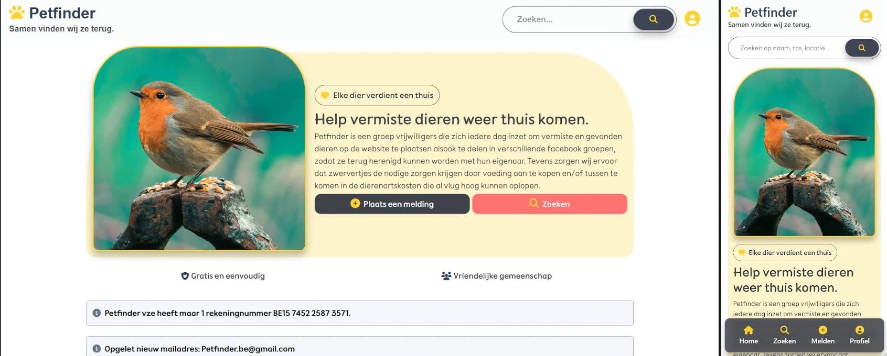

# Petfinder: Together We Find Them

## Demo Video

<a href="https://vimeo.com/user264746150/petfinder-demo?fl=ip&fe=ec">
  
</a>


## Overview

**Petfinder** is a full-stack web application that connects communities to reunite lost animals with their owners. Built in **6 weeks (total)** as a solo project by a developer with 4 months of Laravel experience and less than a year of total coding experience.

The application demonstrates production-grade architecture decisions: recursive comment threading with depth management, soft-delete patterns using Eloquent observers, full-text search via Typesense with Docker containerization, Redis caching, test coverage, and complex bulk operations, none of which are typical first projects.

### 

⚠️ Important Notes <br>
**Live Demo:** The demo is not currently hosted live due to infrastructure costs. <br>
**Source Code:** The complete source code repository is maintained as a **private repository**. This public repository serves as a reference and documentation hub.

## What Makes This Project Special

### 1. **Recursive Comment System with Depth Management**

A threaded comment section that mirrors Reddit's structure, comments can have unlimited replies, but replies are constrained at configurable depths to preserve UX and database performance.

**Key Implementation Details:**

- Comments stored in a single table with parent-child relationships using `parent_id`
- Query loading via Laravel's `with()` eager loading
- Depth-based reply constraints: users cannot reply beyond depth 4; further interactions route through a dedicated comment tree view
- Collapsible comment threads for readability
- Comment editing with `(edited)` indicator
- Soft-deletion preserves the entire tree, deleted comments display as `[deleted]` while maintaining structural integrity

```php
// ? RECURSIVE COMMENT COUNT LOGIC
    public function countTotalComments()
    {
        $count = $this->repliesRecursive->count();

        foreach ($this->repliesRecursive as $reply) {
            $count += $reply->countTotalComments();
        }

        return $count;
    }
```

**Why This Choice:** Building a recursive comment system is non-trivial. Most developers avoid it on first major projects. This showcases database design thinking and UX consideration.

---

### 2. **Soft-Delete Architecture & Observer Pattern**

When a user deletes their account, their comments should be soft-deleted (not cascade-deleted), preserving conversation threads. This required solving a subtle race condition.

**The Problem:**

Database foreign key `onDelete('cascade')` executes *before* Laravel observers fire. By the time the observer runs, the `user_id` is already NULL, and the query finds nothing to soft-delete.

**The Solution:**

Use the `deleting()` event (fires before deletion) instead of `deleted()`:

```php
// UserObserver.php
 // ? WHY ARE WE USING DELETING
    // The issue stems from a race condition with database foreign key constraints. 
    // When a user is deleted, the database's onDelete('set null') constraint executes 
    // automatically, setting comments.user_id to NULL before the observer's deleted() 
    // event fires. By the time the observer runs and queries for comments, all records 
    // have already lost their user_id reference, resulting in zero matches.

    /**     
     * Handle the User "deleting" event.     
     * Fires BEFORE the deletion occurs.     
     */
    public function deleting(User $user): void
    {
        // ? WE ARE SOFT DELETING COMMENTS OF USER WHEN DELETION OCCURS. SO THAT THE COMMENTS DONT GET DELETED
        DB::transaction(function () use ($user) {
            // ? SOFT DELETE USER'S COMMENTS ON EVERY POST
            $comments = Comment::where('user_id', $user->id)->get();
            $posts = AnimalPost::where('user_id', $user->id)->get();
            foreach ($comments as $comment) {
                Cache::tags(["post_comments_{$comment->commentable_id}"])
                    ->flush();
                $comment->delete();
            }

            foreach ($posts as $post) {
                $post->unsearchable();
                $post->forceDelete();
            }
        });
    }
```

The observer also ensures **Typesense indexing stays in sync**, when posts are deleted through the controller, the observer triggers the search index update, preventing orphaned records.

---

### 3. **Full-Text Search with Typesense & Docker**

Posts are indexed in **Typesense** (a production-grade search engine) with multiple filters: 
animal sex, animal type name, animal breed name, status, animal name, animal color, province, title, description, country.

**Architecture:**

- Typesense runs in a **Docker container** for consistency across environments
- Posts sync to Typesense via controllers (will be updated in future implementation to use observers)
- Pagination handled efficiently without loading entire result sets
- Mobile-optimized search filters


**Why This Choice:** Typesense + Docker is enterprise-level infrastructure for a student project. Most developers reach for basic MySQL LIKE queries.

---

### 4. **Redis Caching & Observer Automation**

Comments are cached and invalidated automatically after CRUD operations.

```php
// Comment Observer - keeps cache index in sync
 /**
     * Handle the Comment "created" event.
     */
    public function created(Comment $comment): void
    {
        $this->invalidatePostCommentCache($comment);
    }

    /**
     * Handle the Comment "updated" event.
     */
    public function updated(Comment $comment): void
    {
        $this->invalidatePostCommentCache($comment);
    }

    /**
     * Handle the Comment "deleted" event.
     */
    public function deleted(Comment $comment): void
    {
        Log::info('Comment deleted observer fired', ['comment_id' => $comment->id, 'commentable_id' => $comment->commentable_id,]);
        $this->invalidatePostCommentCache($comment);
    }

    /**
     * Handle the Comment "restored" event.
     */
    public function restored(Comment $comment): void
    {
        $this->invalidatePostCommentCache($comment);
    }

    /**
     * Handle the Comment "force deleted" event.
     */
    public function forceDeleted(Comment $comment): void
    {
        $this->invalidatePostCommentCache($comment);
    }

    private function invalidatePostCommentCache(Comment $comment)
    {
        Cache::tags(["post_comments_{$comment->commentable_id}"])
            ->flush();
    }
```

This prevents recalculating comment trees on every page load, a common performance bottleneck.

---

### 5. **Bulk Operations with Database Transactions**

Users can bulk delete or restore their own posts and delete their comments. The admin can perform these operations on any user's content.

```php
public function bulkRestore(Request $request)
    {
        $validated = $request->validate([
            'checkboxIds.*' => ['exists:animal_posts,id']
        ]);

        $allIds = $validated['checkboxIds'];

        DB::transaction(function () use ($allIds) {
            foreach ($allIds as $id) {
                $animalPost = AnimalPost::onlyTrashed()->find($id);
                Gate::allows('restore', $animalPost);

                $animalPost->restore();
                $animalPost->searchable(); // ? REMOVE FROM TYPESENSE INDEX
            }
        });

        if (Auth()->user()->roles->contains('name', 'user')) {
            $route = 'user.dashboard';
        } else {
            $route = 'admin.dashboard';
        }

        return redirect()->route($route)->with('posts_restored', 'Uw post(s) is/zijn succesvol hersteld!');

    }
```

**Why This Choice:** Bulk operations require careful transaction handling and cache invalidation. Doing this correctly prevents data inconsistencies.

---

### 6. **Testing & Factories**

Tests verify authentication, soft deletion, bulk operations, and search functionality. Factories randomize data generation:


```php
 public function test_user_can_put_one_post_in_bin(): void
    {
        $animalPostCollection = $this->createTestPosts();
        $animalPost = $animalPostCollection->first();

        $this->softDeletePost($animalPost);

        $this->deleteEverythingAfterTestOperation($animalPostCollection);
    }

    public function test_user_can_put_multiple_posts_in_bin(): void
    {
        $animalPostCollection = $this->createTestPosts(3);

        $this->bulkOperations($animalPostCollection);

        $this->deleteEverythingAfterTestOperation($animalPostCollection);
    }

    public function test_user_can_restore_one_post_in_bin(): void
    {
        $animalPostCollection = $this->createTestPosts();
        $animalPost = $animalPostCollection->first();

        $this->softDeletePost($animalPost);

        $this->bulkOperations($animalPostCollection, BulkOperation::RESTORE);

        $this->deleteEverythingAfterTestOperation($animalPostCollection);
    }
    public function test_user_can_restore_multiple_posts_in_bin(): void
    {
        $animalPostCollection = $this->createTestPosts(3);

        $this->bulkOperations($animalPostCollection);

        $this->bulkOperations($animalPostCollection, BulkOperation::RESTORE);

        $this->deleteEverythingAfterTestOperation($animalPostCollection);
    }

    public function test_user_can_permanently_delete_one_post_in_bin(): void
    {
        $animalPostCollection = $this->createTestPosts();
        $animalPost = $animalPostCollection->first();

        $this->softDeletePost($animalPost);

        $this->bulkOperations($animalPostCollection, BulkOperation::DESTROY);

        $this->deleteEverythingAfterTestOperation($animalPostCollection);
    }

    public function test_user_can_permanently_delete_multiple_posts_in_bin(): void
    {
        $animalPostCollection = $this->createTestPosts(3);

        $this->bulkOperations($animalPostCollection);

        $this->bulkOperations($animalPostCollection, BulkOperation::DESTROY);

        $this->deleteEverythingAfterTestOperation($animalPostCollection);
    }

    public function test_user_cannot_delete_another_users_post(): void
    {
        $animalPostCollection = $this->createTestPosts();
        $otherUser = $this->createTestUser();
        $post = $animalPostCollection->first();

        $response = $this
            ->actingAs($otherUser)
            ->delete(route('animal-post.delete', $post));

        $response->assertForbidden();
        $this->assertDatabaseHas('animal_posts', ['id' => $post->id, 'deleted_at' => null]);

        $this->actingAs($post->user);
        $this->deleteEverythingAfterTestOperation($animalPostCollection);

        $this->actingAs($otherUser);
        $this->deleteEverythingAfterTestOperation(user: $otherUser);

    }
```


**Factory (+Seeding) with randomization:**

```php
/**
     * Run the database seeds.
     */
    public function run(): void
    {
        $animalPosts = AnimalPost::all();
        $randomAmountOfComments = rand(1, 3);
        foreach ($animalPosts as $post) {
            $rootComments = Comment::factory()->state([
                'commentable_id' => $post->id
            ])
                ->count($randomAmountOfComments)
                ->create();

            foreach ($rootComments as $comment) {
                $this->createNestedComments($comment, $post);
            }
        }

        // $randomReplyDepth = rand(0, 4);

    }

    private function createNestedComments(Comment $parentComment, AnimalPost $post, $depth = 0, $maxDepth = 5)
    {
        if ($depth > $maxDepth) {
            return;
        }

        $randomReplyAmount = rand(0, 3);

        $replies = Comment::factory()->state([
            'commentable_id' => $post->id
        ])->asReply($parentComment)
            ->count($randomReplyAmount)
            ->create();

        // ? AN EMPTY Collection can still be iterated if empty but i wrote 'return' to make the code more explicit
        // ? if the reply count for the parent comment is 0.
        // ? The branch ends and we move on to the next parent comment
        if ($replies->isEmpty()) {
            return;
        }

        // ? CREATING RECURSIVE COMMENTS 
        foreach ($replies as $reply) {
            $this->createNestedComments($reply, $post, $depth + 1, $maxDepth);
        }
    }
```

## Feature Showcase

| Feature | Implementation | Portfolio Value |
|---------|-----------------|-----------------|
| **User Authentication** | Laravel Auth with session/cookie security | Security awareness |
| **CRUD Operations** | Full create, read, update, delete with permissions | Full-stack fundamentals |
| **Soft Deletion** | Trash bin functionality with restore capability | Data integrity thinking |
| **Recursive Comments** | Unlimited nesting with depth constraints | Complex data structures |
| **Full-Text Search** | Typesense + Docker with multi-field filtering | Modern infrastructure |
| **Redis Caching** | Automatic invalidation via observers | Performance optimization |
| **Bulk Operations** | Transactional multi-record updates | Database reliability |
| **Middleware & Throttling** | Request throttling and role-based access | Security & scalability |
| **Mobile Responsiveness** | Tailwind CSS with mobile-first design | Cross-platform competency |
| **Admin Dashboard** | Analytics, user management, content moderation | Full-stack depth |

## Debugging & Problem-Solving

### Issue #1: Hidden Laravel UUID Session Bug

**The Problem:**

Login appeared successful, session cookie existed, user was authenticated. But on the next request, Laravel treated the user as a guest. No errors. No visible failures.

**Root Cause:**

The sessions table used `foreignId()` (unsigned integer), but the User model used UUID. When the session was written, Laravel stored the UUID string in an integer column, which truncated to `NULL`.

**The Fix:**

```php
// Migration fix
$table->foreignUuid('user_id')->nullable()->index();
```

Clear old sessions and authenticate again, it works.

**What This Taught Me:**

Systems can fail silently at configuration boundaries. You can't just check the login response, you must inspect the session payload, database schema, authentication guard, user provider, and the *next* request. This bug forced me to think in systems, not isolated components.

### Issue #2: Account Deletion & Comment Soft-Delete Race Condition

**The Problem:**

When a user deleted their account, comments should soft-delete (preserve the thread). Instead, `deleted_at` stayed NULL while `user_id` became NULL, the worst of both worlds.

**Root Cause:**

Database foreign key `onDelete('set null')` executes *before* Laravel observers. The observer fired after the `user_id` was already NULL, so `Comment::where('user_id', $user->id)->get()` returned zero results.

**The Solution:**

Use `deleting()` instead of `deleted()`. The `deleting()` event fires *before* the deletion, preserving the user_id reference:

```php
  public function deleting(User $user): void
    {
        // ? WE ARE SOFT DELETING COMMENTS OF USER WHEN DELETION OCCURS. SO THAT THE COMMENTS DONT GET DELETED
        DB::transaction(function () use ($user) {
            // ? SOFT DELETE USER'S COMMENTS ON EVERY POST
            $comments = Comment::where('user_id', $user->id)->get();
            $posts = AnimalPost::where('user_id', $user->id)->get();
            foreach ($comments as $comment) {
                Cache::tags(["post_comments_{$comment->commentable_id}"])
                    ->flush();
                $comment->delete();
            }

            foreach ($posts as $post) {
                $post->unsearchable();
                $post->forceDelete();
            }
        });
    }
```

**What This Taught Me:**

Event ordering matters. Database constraints and application logic can conflict. Understanding the lifecycle of operations (deleting vs. deleted, creating vs. created) is critical for correct behavior.

---

## Tech Stack

| Layer | Technology | Why |
|-------|-----------|-----|
| **Backend** | Laravel 13 | Industry-standard PHP framework with rich ecosystem |
| **Frontend** | JavaScript + Tailwind CSS | Responsive, maintainable styling + API Fetching|
| **Database** | MySQL | ACID compliance for transactions |
| **Search** | Typesense + Docker | Production-grade full-text search |
| **Caching** | Redis + Docker | Fast cache invalidation via tagging |
| **Testing** | Laravel Tests (PHPUnit) | Coverage for critical paths |
| **Containerization** | Docker | Consistent local environments |

---

## Mobile UI

<table class="w-full">
  <tr>
    <td></td>
    <td></td>
    <td></td>
    <td></td>
  </tr>
  <tr>
    <td></td>
    <td></td>
    <td></td>
    <td></td>
  </tr>
</table>

The application is fully responsive, optimized for interactions and small screens. Key mobile features include:

- Collapsible navigation and comment threads
- Optimized search filters for mobile constraints
- Fast loading with image optimization

---

## Database Seeding & Factories

**GIF: Running_db_seed_operation**


The project includes factories that randomize:

- Number of uploaded images per post (2–4) -> min:2 | max:4
- Comment counts and nesting depth
- User roles and permissions
- Post status and metadata

This enables rapid testing and demo data generation.

---

## Bulk Operations in Action

**GIF: Bulk_operations_in_action**


- Select multiple posts
- Soft delete with transaction safety
- Restore from trash
- Admin operations on any user's content
- Real-time cache invalidation

---

## Key Learning Outcomes

**First-Time Implementations:**

- Recursive comment system with depth constraints
- Typesense full-text search with Docker
- Bulk operations with transactional safety
- Observer pattern for automatic synchronization
- Redis caching with automatic invalidation
- Test coverage
- Soft deletion patterns
- Enum usage for type safety
- Middleware and request throttling

**Development Timeline:** 6 weeks, solo developer  
**Experience Level at Start:** 4 months of Laravel, <1 year total coding  
**Outcome:** Production-grade architecture with zero code reuse from templates

---

## Why This Project Matters for My Career

This project demonstrates:

1. **Fast Learning:** Shipped a complex full-stack application in 6 weeks with less than a year of coding experience
2. **Full-Stack Competency:** Backend architecture (observers, transactions, caching) + frontend (responsive UI, mobile optimization)
3. **Production Thinking:** Chose enterprise tools (Typesense, Redis, Docker) and implemented them on the first try
4. **Problem-Solving:** Debugged subtle race conditions and architectural mismatches independently
5. **Code Quality:** Comprehensive tests, factories, and migrations, not a hack project
6. **Solo Execution:** Every feature built, tested, and debugged without guidance


## What's Next

Planned improvements:

**If project is taken further:**
- Improvement on recursive comments system. Adding on-demand loading through API request.
- Image optimasations
- Real-time notifications via WebSockets
- Map integration for lost animal locations
- User rating system for trust building
- Email notifications for new matches


## Contact & Feedback

This README showcases a project built with intention and care. If you'd like to discuss architecture decisions, debugging approaches, or full-stack development, I'm available for discussion.

